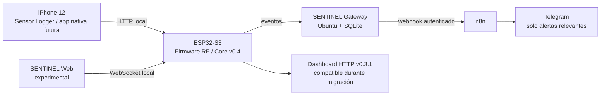
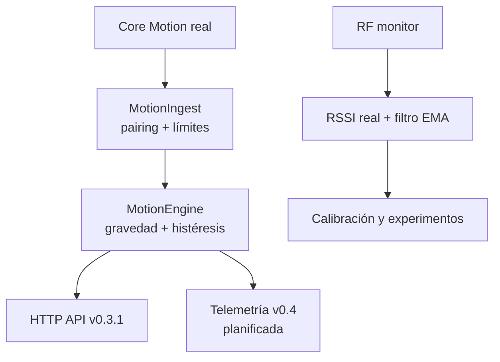

# SENTINEL-LAB

Plataforma abierta de experimentación física, telemetría en tiempo real y
automatización para un laboratorio local con ESP32-S3 e iPhone.

SENTINEL-LAB nace del firmware SENTINEL RF v0.3.1 y evoluciona hacia una
arquitectura con protocolo compartido, interfaz web en tiempo real, gateway en
Ubuntu, integración n8n y una aplicación iOS privada.

## Objetivo físico y científico

- Capturar movimiento real con acelerómetro y gravedad nativos.
- Observar RSSI real de estaciones Wi-Fi asociadas al AP del ESP32.
- Calibrar modelos de propagación con distancias medidas físicamente.
- Registrar eventos de movimiento, señal y reconexión con marcas de tiempo.
- Experimentar sin presentar simulación como medición ni inventar precisión.

## Hardware y entorno

| Componente | Estado |
|---|---|
| ESP32-S3 N16R8 | 16 MB flash, 8 MB PSRAM |
| AP LAB | `SENTINEL-LAB`, `192.168.4.1` |
| Cliente móvil actual | iPhone 12 con iOS 27.0 y Sensor Logger |
| Servidor | Ubuntu 24.04, n8n autoalojado |
| Desarrollo | Linux, PlatformIO, Python, Node |
| Puerto de carga verificado | `/dev/ttyACM0` mediante puente USB-serie |

## Arquitectura objetivo





## Estado real de implementación

| Componente | Estado |
|---|---|
| Firmware RF v0.3.1 | **Implemented, software tested, hardware tested** |
| API HTTP v0.3.1 | **Implemented, software tested, hardware tested** |
| Sensor Logger → ESP32 | **Hardware tested por el usuario**; evidencia pendiente de archivar |
| Dashboard embebido RF | **Implemented, hardware tested** |
| MotionEngine / MotionIngest | **Implemented, software tested** |
| WebSocket y telemetría v0.4 | **Planned** |
| SENTINEL Web | **Planned** |
| SENTINEL Gateway | **Planned** |
| Workflows n8n importables | **Planned** |
| App SwiftUI privada | **Planned**; requiere macOS/Xcode y firma válida |
| Producción | **Not production ready** |

La compilación e instalación de SwiftUI **no se afirma desde Linux**. Requiere
Xcode, provisioning y firma en un entorno Apple legítimo.

## Estructura actual y migración

El repositorio conserva por ahora la estructura funcional del proyecto original:

```text
.
├── platformio.ini
├── include/
├── src/
├── test/
├── tools/
├── docs/
├── integrations/n8n/
├── build/rf-validation.json
└── .github/
```

La estructura objetivo `apps/`, `firmware/`, `services/`, `packages/` y `docs/*`
 se migrará por etapas. No se moverán archivos sin verificar rutas relativas,
imports, PlatformIO, pruebas y scripts.

## Compilación y pruebas

```bash
python3 tools/check_software.py

for env in sentinel_esp32s3_n16r8 \
           sentinel_esp32s3_n16r8_diag \
           sentinel_esp32s3_n16r8_v02 \
           sentinel_esp32s3_n16r8_rf; do
  pio run -e "$env" || exit 1
done
```

El artefacto RF validado tiene SHA256:

```text
918d9157f6308e84fb022faf0825ca37fb41ebc2edee28dcf70f22dce0f55799
```

No se flashea automáticamente en CI. La carga requiere autorización explícita.

## Uso del laboratorio

1. Conectar el iPhone a `SENTINEL-LAB`.
2. Configurar Sensor Logger con `Accelerometer` + `Gravity` y HTTP Push a
   `http://192.168.4.1/api/motion/sensorlogger`.
3. Autorizar el `deviceId` en `http://192.168.4.1/motion/native`.
4. Verificar `/api/motion/status` y `/api/state`.
5. Medir RSSI y distancias reales, calibrar y exportar CSV antes de reiniciar.

Ver:

- [Guía iOS](docs/rf-ios.md)
- [Demostración y calibración](docs/rf-demo.md)
- [Protocolo HTTP](docs/rf-protocol.md)
- [Validación física](docs/rf-hardware-validation.md)
- [Inventario P0](docs/validation/p0-audit.md)

## Seguridad

- No hay credenciales versionadas.
- `include/secrets.h`, `.env` y certificados están excluidos por Git.
- `include/secrets.example.h` es la única plantilla pública.
- HTTP local sin TLS se limita a la red de laboratorio.
- Los tokens de dispositivo y el transporte protegido del gateway forman parte
  del diseño de v0.4.0.

## Limitaciones conocidas

- RSSI no determina distancia ni dirección exacta.
- Resultados y calibraciones están en RAM; se pierden al reiniciar.
- Safari sobre HTTP no puede acceder a Core Motion sin contexto seguro.
- Firefox iOS puede mostrar «Resumen no disponible» al agitar; es un toast del
  navegador, no un error del firmware.
- n8n y Telegram no están desplegados ni autorizados para producción.
- No se ha elegido licencia; requiere decisión del propietario.

## Roadmap

| Etapa | Contenido |
|---|---|
| P0 | Fundación del repositorio, gobernanza y CI base |
| P1 | Protocolo compartido versionado y validación de esquemas |
| P2 | Core v0.4.0: WebSocket, telemetría y emparejamiento |
| P3 | SENTINEL Web experimental |
| P4 | Gateway, SQLite, Docker y n8n importable |
| P5 | Estructura SwiftUI y documentación de firma |

## Gobernanza

- [Contribución](CONTRIBUTING.md)
- [Seguridad](SECURITY.md)
- [Instrucciones para agentes](AGENTS.md)
- [Cambios](CHANGELOG.md)
- [Arquitectura](docs/architecture/overview.md)
- [Decisiones](docs/decisions/)
