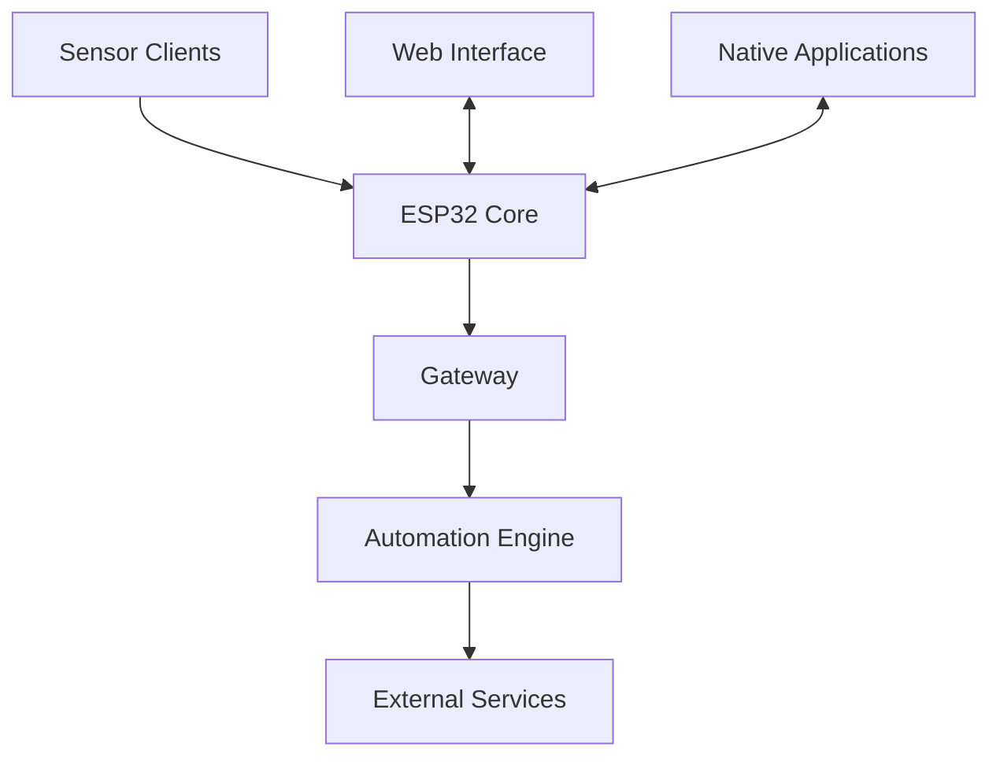

# SENTINEL-LAB


**Open-source platform for physical experimentation, real-time telemetry, and intelligent automation.**

SENTINEL-LAB is an experimental platform built around ESP32-based sensing, wireless monitoring, and real-time data processing. It combines embedded systems, modern interfaces, and automation workflows into a modular environment for scientific research and development.

## Overview

SENTINEL-LAB focuses on connecting physical measurements with real-time software systems.

Key capabilities include:

- **Motion Sensing:** Capture and analyze acceleration, gravity, and movement events.
- **Wireless Monitoring:** Observe Wi-Fi signal strength (RSSI) and study radio propagation.
- **Real-Time Telemetry:** Stream sensor data and system events with minimal latency.
- **Experimental Analysis:** Calibrate measurement models, compare results, and export data.
- **Automation:** Integrate event-driven workflows and external notification services.

## Architecture



The platform is designed around independent, reusable components:

| Component | Purpose |
|---|---|
| **SENTINEL Core** | Embedded sensing, RF monitoring, and event processing |
| **SENTINEL Web** | Real-time monitoring and experimental controls |
| **SENTINEL Gateway** | Data ingestion, persistence, and integration |
| **SENTINEL Native** | Native applications for sensor access and monitoring |
| **Automation Engine** | Event-driven workflows and notifications |

## Development Status

| Component | Path | Status |
|---|---|---|
| Firmware HTTP v0.3.1 (`_rf`) | `src/rf`, `src/v02` | Unchanged, hardware tested |
| SENTINEL Core realtime v0.4.1 (`_realtime`) | `src/realtime` | **Hardware tested** on the ESP32-S3 (18/18 checks, ~6.5 min run) |
| Protocol v1 1.0.0 | `packages/protocol` | Schemas, validator, fixtures |
| Gateway (time authority, web host, read-only proxy) | `tools/sentinel_gateway.py` | Host and hardware tested |
| Web dashboard (React + [Arc Library](https://github.com/kuratlielia/arc-library)) | `apps/web` | Host tested; rendered against hardware via headless Chromium |
| iPhone app (SwiftUI) + SentinelKit | `apps/ios` | Compiled in CI (simulator and unsigned device); **never run on an iPhone** |

Installing the iPhone app requires macOS, Xcode and an Apple ID; no signed IPA
exists. See [docs/ios/README.md](docs/ios/README.md).

Key documents: [integration report](docs/validation/p3-integration.md),
[realtime core](docs/realtime-core.md), [gateway](docs/gateway.md),
[web](docs/web/README.md), [ESP32 update](docs/hardware/update-esp32.md),
[full recovery](docs/hardware/p2-full-recovery.md),
[ADR-0006](docs/decisions/ADR-0006-autoridad-de-tiempo-y-gateway.md).

### Quick start (lab network only)

```bash
python3 tools/check_software.py                      # host tests
(cd apps/web && npm ci && npm run build)             # web dashboard
# join the SENTINEL-LAB access point, then:
python3 tools/sentinel_gateway.py --token-file ~/.config/sentinel-lab/realtime-token
# open http://127.0.0.1:8080
```

**Status:** Experimental — not production-ready. HTTP/WebSocket are unencrypted
and intended only for the isolated laboratory AP.

## Technology

- **Embedded:** ESP32, C++, PlatformIO
- **Frontend:** Web technologies, WebSocket
- **Native:** Swift, SwiftUI
- **Backend:** Linux, SQLite, Docker
- **Automation:** n8n
- **Testing:** Python, automated validation

## Roadmap

- [x] Embedded firmware and sensor monitoring
- [x] HTTP API and initial dashboard
- [x] Motion ingestion and RF experiments
- [x] Versioned protocol contract
- [x] Firmware WebSocket telemetry (v0.4.1, hardware-tested)
- [x] Next-generation web dashboard (Arc Library)
- [x] Local gateway (time authority, web host)
- [ ] Native iPhone app on a physical device (built in CI, not installed)
- [ ] Long-duration soak and automation integration

## Principles

- Real measurements over simulated results.
- Modular, maintainable architecture.
- Reproducible scientific experiments.
- Clear separation between tested and planned features.
- Security and reliability by design.

---

*SENTINEL-LAB — Bridging physical systems and real-time intelligence.*
