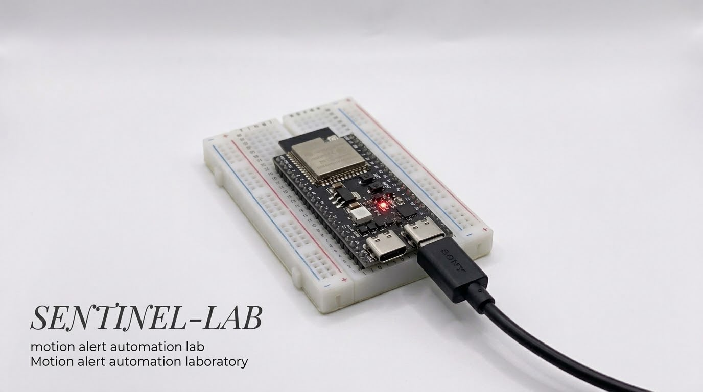
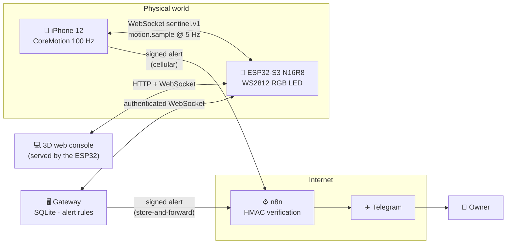
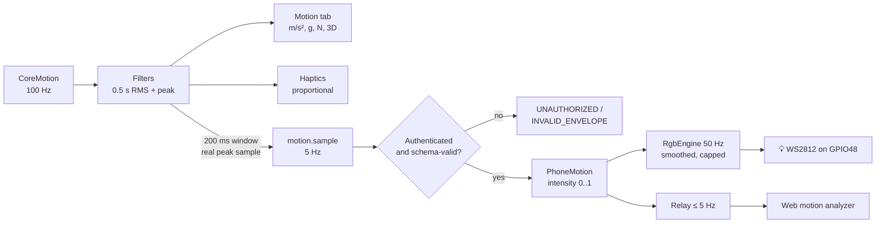
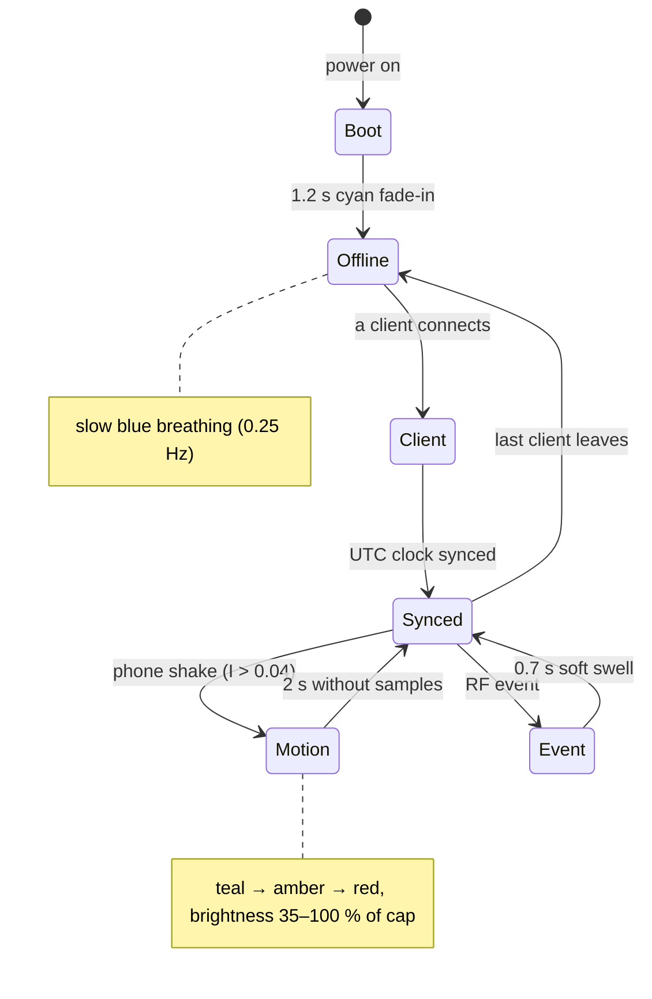
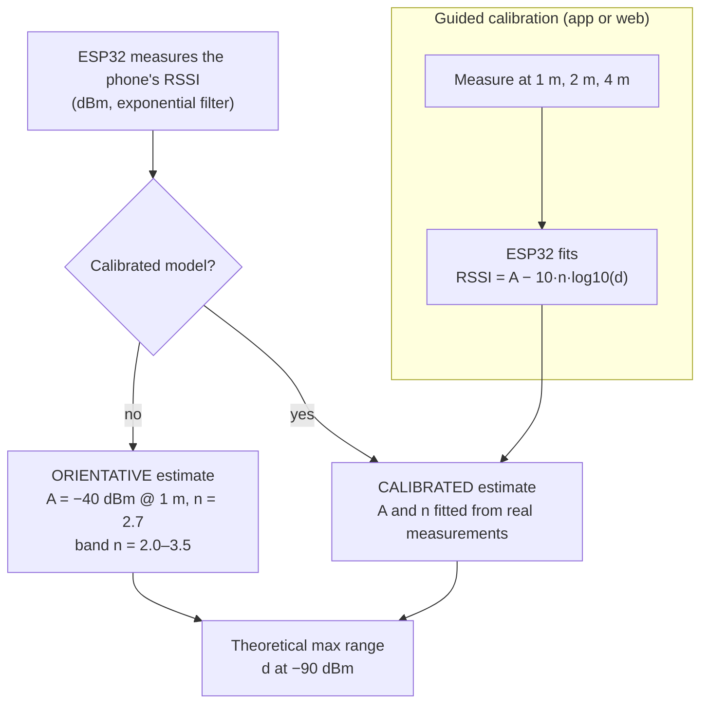
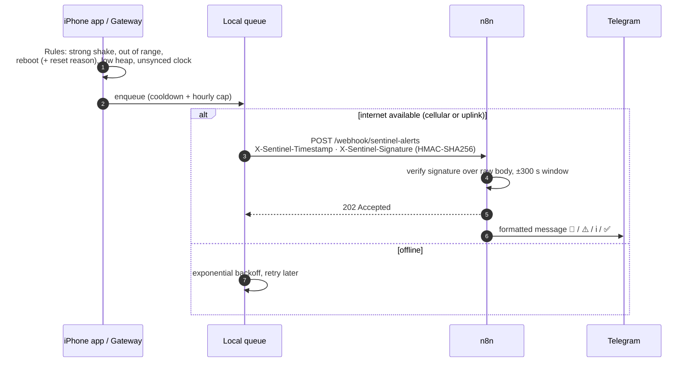
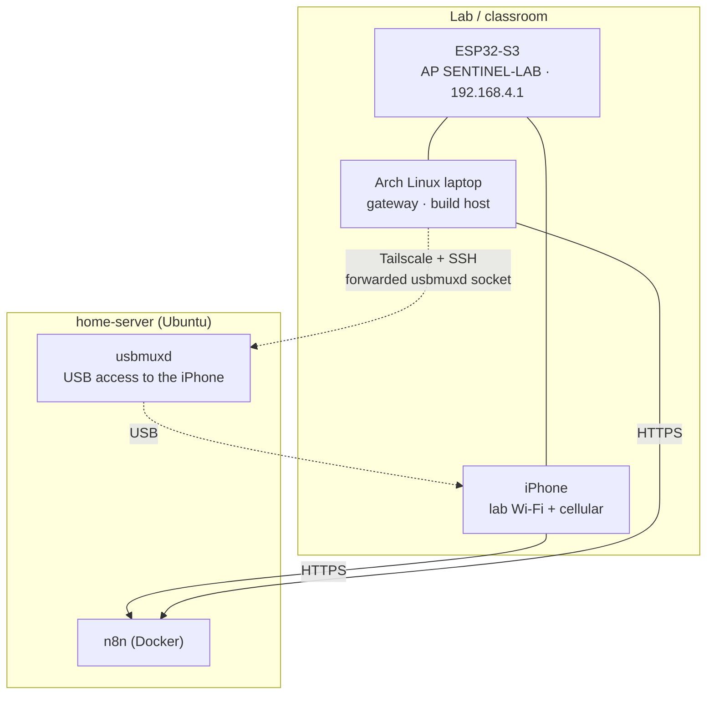

<div align="center">



# SENTINEL-LAB

**A connected physics lab and tamper sentinel built on a real ESP32-S3, an iPhone used as a measuring instrument, and a 3D web console.**

[](https://github.com/Santy401/SENTINEL-LAB/actions/workflows/firmware-build.yml)
[](https://github.com/Santy401/SENTINEL-LAB/actions/workflows/firmware-host-tests.yml)
[](https://github.com/Santy401/SENTINEL-LAB/actions/workflows/protocol-validation.yml)
[](https://github.com/Santy401/SENTINEL-LAB/actions/workflows/ios.yml)
[](https://github.com/Santy401/SENTINEL-LAB/actions/workflows/web.yml)
[](https://github.com/Santy401/SENTINEL-LAB/actions/workflows/secret-scan.yml)

`ESP32-S3` · `C++17` · `WebSocket sentinel.v1` · `SwiftUI` · `CoreMotion` · `SceneKit` · `React` · `three.js` · `Python` · `SQLite` · `n8n` · `Telegram`

</div>

---

## What it does

Shake the iPhone and **the physics shows up everywhere at once**:

- The app measures the real acceleration with CoreMotion at 100 Hz and shows it in m/s², g and newtons (F = m·a).
- It streams that motion to the ESP32 over a validated WebSocket protocol.
- The board's **physical RGB LED** fades from teal to amber to red as the shake grows.
- The 3D web console, served by the ESP32 itself, plots the same curve live.
- A hard hit raises a **signed alert that reaches Telegram** over mobile data.

Everything shown as a measurement is a real measurement. Estimates such as Wi-Fi distance are labelled as estimates, together with their uncertainty.

| | |
|---|---|
| 🔌 **Firmware** | ESP32-S3 access point, HTTP API, WebSocket `sentinel.v1`, RGB engine, motion relay, self-diagnostics |
| 📱 **iPhone app** | Motion physics, interactive 3D board, Wi-Fi distance with guided calibration, haptics, alerts |
| 💻 **Web console** | 3D ESP32-S3 model, RSSI radar, motion analyzer, experiments, exhibition mode; served from the board's flash |
| 🖥️ **Gateway** | Time authority, SQLite history, alert rules, store-and-forward delivery, printable reports |
| ⚙️ **Automation** | n8n workflow that checks the HMAC signature on each alert and forwards it to Telegram |

---

## Applications

| Domain | Problem | How SENTINEL-LAB solves it |
|---|---|---|
| 🛡️ **Asset protection** | A valuable instrument, sample box or loaned device is moved, dropped or tampered with unnoticed | The phone attached to the asset detects shocks; the LED turns red and the owner gets a Telegram alert in seconds |
| 📍 **Perimeter awareness** | Equipment leaves the room | The ESP32 tracks the phone's signal strength; an "out of range" alert fires below −85 dBm or when the phone disappears |
| 🎓 **Physics education** | Acceleration, gravity and force are taught without data | Students shake, tilt and drop the phone and see vectors, forces and the gravity direction in 3D, with matching light |
| 📶 **Wireless coverage studies** | How far does a wireless sensor really reach? | RSSI radar plus experimental calibration at known distances, giving an estimated range with its uncertainty |
| 🩺 **Device health monitoring** | Embedded devices reboot or run out of memory silently | The firmware reports the reset reason, heap, largest free block and stack watermark; the gateway alerts on reboots and low memory |
| 🏛️ **Science fairs and exhibitions** | Demos need to be understandable to non-programmers | A guided 8-step exhibition mode that separates what is measured, what is estimated and what is a demo |

---

## Architecture



All local traffic runs on the board's own isolated Wi-Fi access point, `SENTINEL-LAB`. Nothing local depends on the cloud; only alerts leave the lab.

### Connection and time authority

The board has no real-time clock, and Protocol v1 requires UTC timestamps. The first client that holds the token becomes the **time authority**, and the board does not stream anything until it has been time-synced.

```mermaid
sequenceDiagram
    autonumber
    participant App as iPhone app
    participant ESP as ESP32-S3
    participant Web as Browser

    App->>ESP: WebSocket upgrade<br/>subprotocols: sentinel.v1, sentinel.auth.&lt;token&gt;
    ESP-->>App: 101 Switching Protocols (selects sentinel.v1 only)
    Note over ESP: Clock not synced: no frames yet
    App->>ESP: connection.hello (role ios, UTC timestamp)
    Note over ESP: Valid token, so clock = phone time (clockSource = peer)
    ESP-->>App: connection.hello (firmware 0.5.0)
    loop every 1 s / 5 s / 15 s
        ESP-->>App: rf.telemetry · connection.heartbeat · system.status
        ESP-->>Web: same frames (broadcast)
    end
    App->>ESP: connection.heartbeat every 15 s (re-syncs the clock)
```

### From motion to light



The physics behind it:

- **Linear acceleration:** `a = userAcceleration × 9.80665` (m/s²).
- **Shake intensity:** `I = clamp(|a| / 8 m/s², 0, 1)`, the same scale on the phone, the firmware and the web.
- **Net force estimate:** `F = m·|a|`, with the iPhone 12 nominal mass of 0.164 kg.
- **No integration to velocity or position:** that error grows without bound, and the UI says so.

### RGB LED states



No effect is faster than 1.5 Hz: there is no strobing, and brightness is capped at 64/255.

### Distance: what is measured and what is estimated



RSSI never gives an exact position. On the radar, only the distance from the centre comes from RSSI; the angle is drawn for display and is labelled as not measured.

### Alert pipeline



### Deployment



---

## Repository layout

```text
.
├── src/, include/            ESP32-S3 firmware (PlatformIO)
│   ├── realtime/             WebSocket server, protocol adapter, RGB engine, motion relay
│   ├── rf/                   RF monitor, lab/calibration API, HTTP routes
│   └── v02/                  Motion engine and Wi-Fi AP (v0.3.1 base)
├── packages/protocol/        Protocol v1 JSON Schemas, validator, valid/invalid examples
├── apps/web/                 React + three.js console (embedded into the firmware)
├── apps/ios/                 SwiftUI app, SentinelKit package, Live Activity widget, xtool adapter
├── tools/                    Gateway, hardware kit, flashing, release staging, host checks
├── integrations/n8n/         n8n workflow templates (no secrets)
├── web_assets/               Deterministic gzip bundle of the web console, linked into flash
├── test/                     C++ host tests, POSIX emulator of the real WebSocket server
├── deploy/                   systemd user unit for the gateway
└── docs/                     Architecture, ADRs, validation evidence, guides
```

---

## Quick start

> All commands are run from the repository root. Secrets (Wi-Fi password, realtime token, alert secret) live in git-ignored files and `chmod 600` files under `~/.config/sentinel-lab/`. They are never committed or printed.

### 1. Firmware

```bash
cp include/secrets.example.h include/secrets.h      # set the AP credentials and SENTINEL_REALTIME_BEARER_TOKEN
python3 tools/check_software.py                     # host tests, emulator, protocol and bundle checks
pio run -e sentinel_esp32s3_n16r8_realtime          # firmware 0.5.0 + embedded web console
python3 tools/p2_stage_release.py --release v0.5.0  # refuses if the partition layout differs (protects NVS)
tools/p2_flash_authorized.sh --environment sentinel_esp32s3_n16r8_realtime \
  --port /dev/ttyACM0 --kit-root ~/p2-hardware-kit --release v0.5.0 \
  --confirm 'FLASH sentinel_esp32s3_n16r8_realtime /dev/ttyACM0'
```

Join the Wi-Fi `SENTINEL-LAB` and open **http://192.168.4.1/**. Full procedure and rollback: [`docs/hardware/update-esp32.md`](docs/hardware/update-esp32.md).

### 2. iPhone app, built on Linux with no Mac

```bash
apps/ios/scripts/linux-toolchain.sh --ubuntu-host <ubuntu-24.04-host>   # Swift 6.4.3 (GPG-verified) + xtool
apps/ios/scripts/linux-toolchain.sh --sdk auto                           # iOS SDK from Apple's Xcode_27.1.xip
xtool auth login --mode password                                         # interactive, free Apple ID
apps/ios/scripts/linux-install.sh --via home-server                      # build, sign, install over USB
```

On macOS you can instead run `cd apps/ios && xcodegen generate` and open the project in Xcode. Guides: [`docs/ios/LINUX.md`](docs/ios/LINUX.md) · [`docs/ios/README.md`](docs/ios/README.md).

### 3. Web console

```bash
cd apps/web && npm ci && npm test && npm run build && cd ../..
python3 tools/embed_web.py          # deterministic gzip bundle → web_assets/ (CI checks it matches)
```

### 4. Gateway and alerts

```bash
python3 tools/sentinel_gateway.py \
  --token-file ~/.config/sentinel-lab/realtime-token \
  --alert-webhook-url https://<your-n8n>/webhook/sentinel-alerts \
  --alert-secret-file ~/.config/sentinel-lab/alert-secret
python3 tools/sentinel_gateway.py alert-test                       # signed test alert → Telegram
python3 tools/sentinel_gateway.py report --session latest --out report.html --pdf
```

n8n and Telegram setup: [`docs/alertas-n8n.md`](docs/alertas-n8n.md) · gateway: [`docs/gateway.md`](docs/gateway.md).

---

## Protocol `sentinel.v1`

Every message is a strict, versioned envelope:

```json
{
  "protocolVersion": "1.0.0",
  "type": "motion.sample",
  "timestamp": "2026-11-22T16:10:02.100Z",
  "sequence": 42,
  "source": "ios-app",
  "sessionId": "ios-run-1",
  "payload": { "...": "type-specific, validated by JSON Schema" }
}
```

| Type | Direction | Purpose |
|---|---|---|
| `connection.hello` / `heartbeat` / `goodbye` | both | Session lifecycle and time sync |
| `rf.telemetry` | ESP32 → clients | Per-client RSSI (raw and filtered), calibrated distance when available |
| `system.status` | ESP32 → clients | Operational state, capabilities, heap |
| `motion.sample` | iPhone → ESP32 → clients | Acceleration, gravity, linear acceleration (m/s²) |
| `motion.status`, `event`, `error` | ESP32 → clients | Motion source state, RF events, protocol errors |

Limits: 4 peers, 1024-byte frames, no fragmentation, 8 messages/s per peer, 5 s handshake deadline, ping every 20 s, 60 s idle timeout. Specification: [`docs/realtime-core.md`](docs/realtime-core.md) · [`packages/protocol`](packages/protocol) · [ADR-0006](docs/decisions/ADR-0006-autoridad-de-tiempo-y-gateway.md).

---

## Verified results

These are real measurements, with evidence stored in the repository:

| Measurement | Result | Evidence |
|---|---|---|
| On-board integration checks | **18/18 pass** | `docs/validation/p3-artifacts/hw-integration-summary.json` |
| Frames validated against the schema | **411/411**, 0 dropped | same |
| Soak on hardware | Same boot for 6.5 min; heap 203 936–203 948 B | same |
| Minimum free loop stack | 5 156–5 480 B of 8 192 | same + `hw-v050-motion-rgb.json` |
| Handshake deadline | 5.01 s → `408` | same |
| LED response to a growing shake | (2,8,3) → (31,8,0) → (47,3,0) → (62,0,0) | `hw-v050-motion-rgb.json` |
| Motion relay | 40/40 schema-valid samples, 0 dropped | same |
| Web console served from flash | 388 KB gzip in 0.3 s | same |
| iOS build on Arch Linux | Builds with xtool and installs on an iPhone 12 | [`docs/ios/LINUX.md`](docs/ios/LINUX.md) |
| Alert webhook | 202 for a valid signature, 401 for a forged one; real Telegram delivery | [`docs/alertas-n8n.md`](docs/alertas-n8n.md) |

Automated tests: C++ host tests (also under ASan/UBSan), a POSIX emulator running the real WebSocket server, Protocol v1 schema contracts, 61 SentinelKit XCTests, 120 Vitest tests and 33 gateway tests. CI runs 7 workflows: 5 firmware builds, iOS on Linux and macOS, web, protocol, repository and secret scanning.

---

## Status

| Component | Version | Status |
|---|---|---|
| Firmware (realtime image) | 0.5.0 | Hardware-tested on the ESP32-S3 N16R8 |
| Firmware HTTP API (v0.3.1 compatibility) | 0.3.1 | Unchanged; the `_rf` image is kept as a rollback |
| Protocol | 1.0.0 | Schemas and fixtures shared by every component |
| iPhone app | 1.2.0 (build 4) | Installed and used on an iPhone 12 |
| Web console | embedded in 0.5.0 | Served by the board; checked in headless Chromium |
| Gateway | 0.2.0 | Host-tested; real alert delivered through n8n |

**Known limitations:**

- **No transport encryption.** Local HTTP and WebSocket are unencrypted and meant for the isolated lab network only. The token stops clients from moving the board's clock or faking motion; it does not encrypt traffic.
- **Live Activity not installable from Linux.** The widget builds in Xcode but cannot be signed by xtool yet (xtool#379).
- **Free Apple ID builds expire.** They last 7 days and are renewed by re-running the install script.
- **Approximate 3D board.** It is an original approximate model, not the official CAD.
- **RSSI distance is an estimate.** It is only meaningful once calibrated.

---

## Documentation

| Topic | Document |
|---|---|
| Project dossier (problems, diagrams, results, jury script) | [`docs/PROYECTO.md`](docs/PROYECTO.md) |
| Realtime core and protocol | [`docs/realtime-core.md`](docs/realtime-core.md) |
| Architecture decisions | [`docs/decisions/`](docs/decisions) |
| Hardware validation | [`docs/validation/p3-integration.md`](docs/validation/p3-integration.md) |
| Firmware update and rollback | [`docs/hardware/update-esp32.md`](docs/hardware/update-esp32.md) |
| iOS (Xcode and Linux) | [`docs/ios/README.md`](docs/ios/README.md) · [`docs/ios/LINUX.md`](docs/ios/LINUX.md) |
| Web console | [`docs/web/README.md`](docs/web/README.md) |
| Gateway and alerts | [`docs/gateway.md`](docs/gateway.md) · [`docs/alertas-n8n.md`](docs/alertas-n8n.md) |
| Contributing and security | [`CONTRIBUTING.md`](CONTRIBUTING.md) · [`SECURITY.md`](SECURITY.md) |

---

## Roadmap

- [x] Bounded WebSocket core with Protocol v1 and hardware validation
- [x] RGB light engine driven by real phone motion
- [x] iPhone app with physics, 3D board, distance and alerts, built without a Mac
- [x] 3D web console served from the board
- [x] Signed alerts to Telegram through n8n
- [ ] Multi-hour soak and published distance-calibration error
- [ ] Multiple ESP32 anchors for measured (not estimated) position
- [ ] Signed OTA updates and encrypted WebSocket (WSS)
- [ ] TestFlight distribution

## Principles

**Real measurements over simulated results** · **clear separation between measured, estimated and demo data** · **contracts before code** · **security and reliability by design**.

<div align="center">

*SENTINEL-LAB: turning a microcontroller and a phone into a laboratory you can hold in your hand.*

</div>
