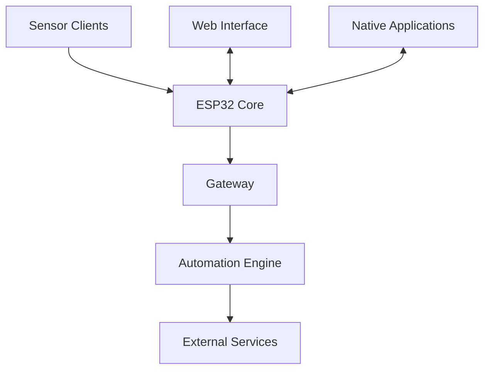

# SENTINEL-LAB

**Open-source platform for physical experimentation, real-time telemetry, and intelligent automation.**

SENTINEL-LAB is an experimental platform built around ESP32-based sensing, wireless monitoring, and real-time data processing. It combines embedded systems, modern interfaces, and automation workflows into a modular environment for scientific research and development.

## Overview

SENTINEL-LAB focuses on connecting physical measurements with real-time software systems.

Key capabilities include:

- **Motion Sensing:** Capture and analyze acceleration, gravity, and movement events.
- **Wireless Monitoring:** Observe Wi-Fi signal strength (RSSI) and study radio propagation.
- **Real-Time Telemetry:** Stream sensor data and system events with minimal latency.
- **Experimental Analysis:** Calibrate measurement models, compare results, and export data.
- **Automation:** Integrate event-driven workflows and external notification services.

## Architecture

The platform is designed around independent, reusable components:

| Component | Purpose |
|---|---|
| **SENTINEL Core** | Embedded sensing, RF monitoring, and event processing |
| **SENTINEL Web** | Real-time monitoring and experimental controls |
| **SENTINEL Gateway** | Data ingestion, persistence, and integration |
| **SENTINEL Native** | Native applications for sensor access and monitoring |
| **Automation Engine** | Event-driven workflows and notifications |

## Development Status

SENTINEL-LAB is under active development.

The current firmware supports HTTP-based monitoring, Wi-Fi RSSI measurements, motion ingestion, and experimental calibration.

Real-time WebSocket telemetry, a redesigned web interface, gateway services, and native applications are planned for future releases.

**Status:** Experimental — not production-ready.

## Technology

- **Embedded:** ESP32, C++, PlatformIO
- **Frontend:** Web technologies, WebSocket
- **Native:** Swift, SwiftUI
- **Backend:** Linux, SQLite, Docker
- **Automation:** n8n
- **Testing:** Python, automated validation

## Roadmap

- [x] Embedded firmware and sensor monitoring
- [x] HTTP API and initial dashboard
- [x] Motion ingestion and RF experiments
- [x] Versioned protocol contract (runtime adapters pending)
- [ ] Next-generation web dashboard
- [ ] Gateway and automation integration
- [ ] Native application development

## Principles

- Real measurements over simulated results.
- Modular, maintainable architecture.
- Reproducible scientific experiments.
- Clear separation between tested and planned features.
- Security and reliability by design.

---

*SENTINEL-LAB — Bridging physical systems and real-time intelligence.*
