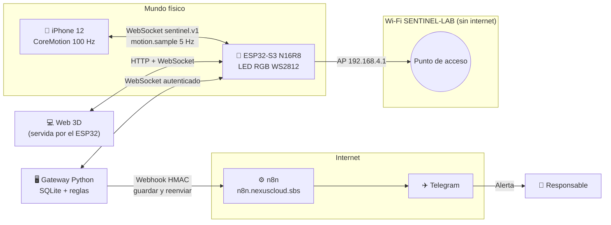
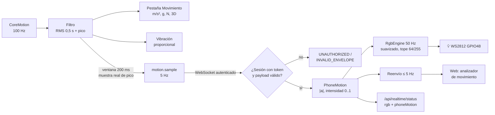
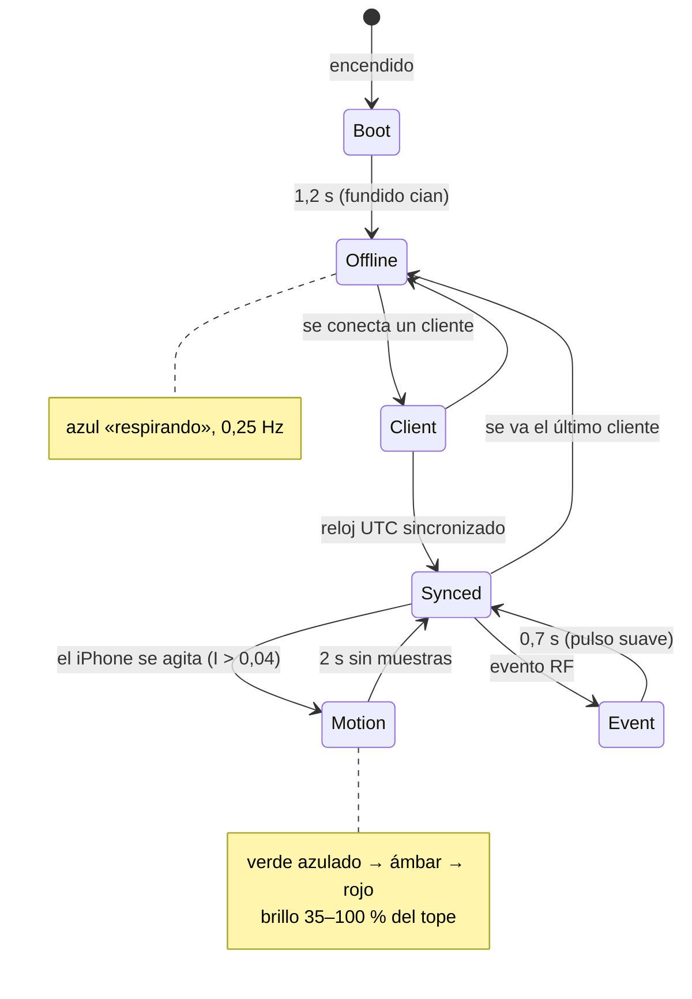
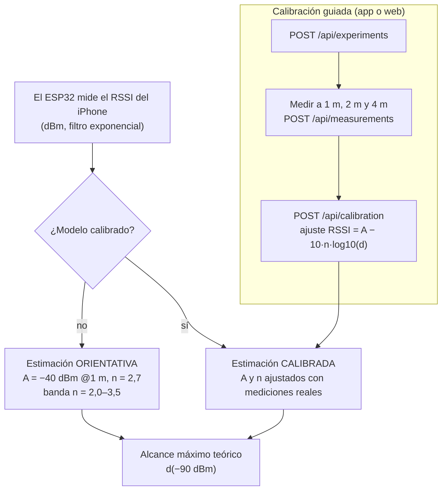
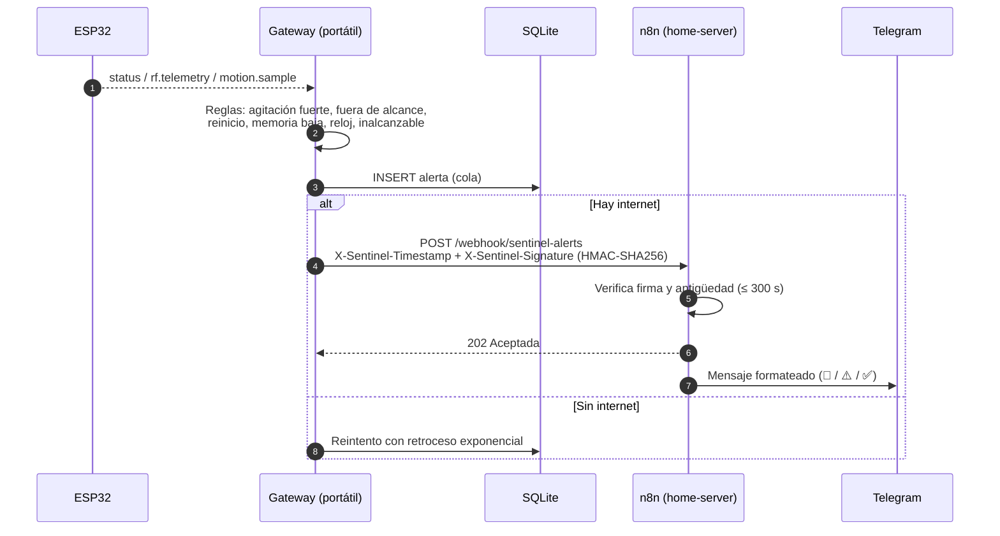
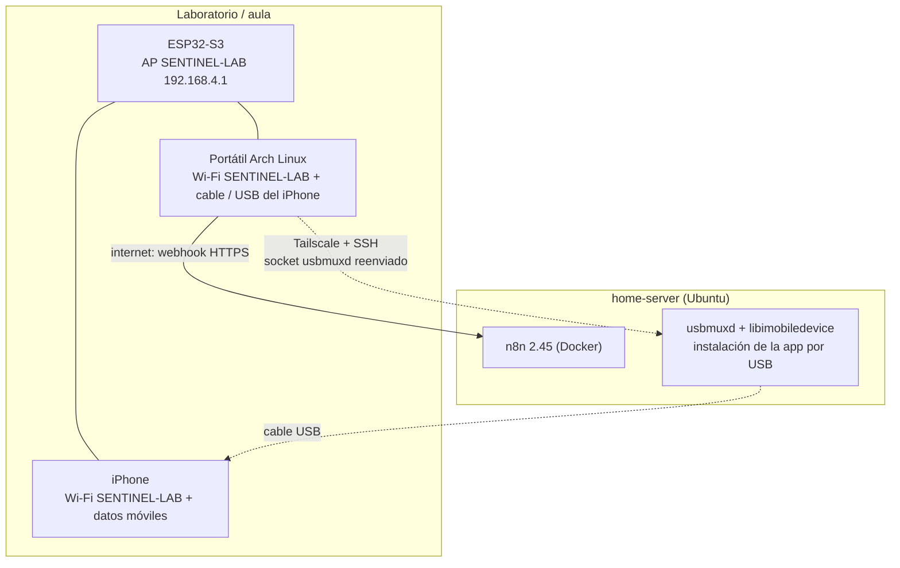
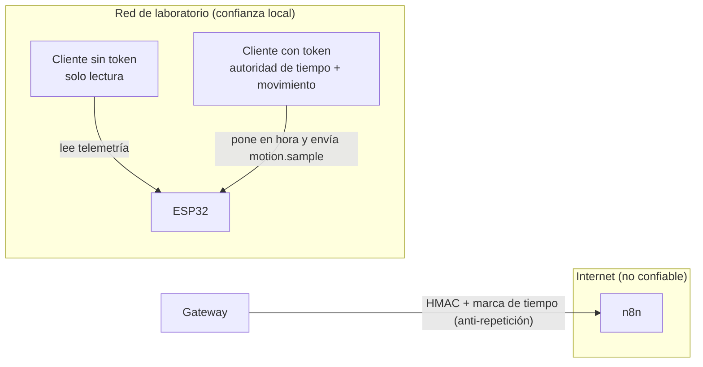
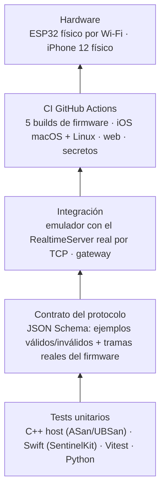

# SENTINEL-LAB — Laboratorio físico conectado

> Un ESP32-S3 real, un iPhone usado como instrumento de medida y una web 3D,
> unidos por un protocolo propio y un sistema de alertas. Sirve para aprender
> física con datos reales y también como centinela que vigila un objeto,
> detecta manipulación y avisa al móvil.

Este documento es la base para la cartelera o la presentación. Cada diagrama
está en Mermaid: GitHub lo dibuja directamente, y también <https://mermaid.live>
y la mayoría de editores de diapositivas con plugin. Todas las cifras de
«Resultados medidos» vienen de pruebas reales en la placa; lo que es estimación
o diseño se indica como tal.

---

## 1. Qué problema resuelve

### 1.1 Problemas del mundo real

| # | Problema | Ejemplo | Cómo lo resuelve SENTINEL-LAB |
|---|---|---|---|
| P1 | **Manipulación o caída de un objeto valioso** | Un instrumento de laboratorio, una caja con muestras o un equipo prestado se mueve o se golpea sin que nadie lo vea | El iPhone pegado al objeto mide la aceleración real (CoreMotion, 100 Hz). Si la agitación supera el umbral, el LED de la placa se pone rojo y llega una alerta al móvil del responsable |
| P2 | **Un objeto sale del perímetro** | Alguien se lleva el equipo fuera del aula | El ESP32 mide la señal Wi-Fi (RSSI) del iPhone. Si cae por debajo de −85 dBm o deja de verse, el sistema alerta de «fuera de alcance» |
| P3 | **Enseñar física es abstracto** | Aceleración, gravedad y fuerza se explican en la pizarra sin datos | El estudiante agita el iPhone y ve en vivo la aceleración en m/s² y g, la fuerza F = m·a en newtons, el vector gravedad en 3D y la luz física respondiendo a su movimiento |
| P4 | **No se sabe hasta dónde llega una red Wi-Fi** | ¿Hasta qué distancia funciona un sensor inalámbrico? | Radar RSSI con calibración experimental: se mide a 1, 2 y 4 m, el ESP32 ajusta el modelo de propagación y estima la distancia y el alcance máximo, indicando siempre su incertidumbre |
| P5 | **Equipos que fallan sin avisar** | Un dispositivo se reinicia o se queda sin memoria y nadie se entera | El firmware informa del motivo de cada reinicio, la memoria y la pila. El gateway lo registra y alerta del reinicio, de la memoria baja o de que el equipo no responde |
| P6 | **Avisar sin internet en el dispositivo** | El laboratorio está aislado y la placa no tiene salida a internet | Guardar y reenviar: el gateway guarda las alertas en SQLite y las envía a n8n en cuanto haya conexión, con firma HMAC. n8n las reenvía a Telegram |

### 1.2 Problemas de ingeniería que hubo que resolver

| Problema técnico | Causa | Solución aplicada |
|---|---|---|
| El ESP32 no enviaba ningún dato en tiempo real | Sin hora UTC válida el protocolo no puede sellar mensajes, y no había fuente de hora (ni token ni NTP) | Un cliente autenticado (gateway, iPhone o web con token) es la **autoridad de tiempo** y pone en hora el reloj al conectarse (ADR-0006) |
| Un navegador no puede enviar el token | La API WebSocket del navegador no permite la cabecera `Authorization` | El token viaja como subprotocolo `sentinel.auth.<token>`; el servidor solo selecciona `sentinel.v1` y nunca lo devuelve |
| iOS descartaba la cabecera de autorización | `URLSession` considera reservada la cabecera `Authorization` | La app envía también el subprotocolo con el token |
| Clientes «fantasma» ocupaban conexiones | Sockets sin handshake, o con FIN TCP sin trama Close | Timeout de 5 s, detección con `recv(MSG_PEEK)` y ping cada 20 s |
| Posible desbordamiento de pila | Temporales de 3 KiB en una pila de 8 KiB | Búferes estáticos. Medido en placa: mínimo 5 156 B libres |
| Pérdida de 1 trama al sincronizar | 4 mensajes coincidían en una cola de 2 | Fases escalonadas y cola de 3. Medido: 0 pérdidas en 411 tramas |
| Compilar una app iOS sin Mac | Xcode solo existe en macOS | xtool + Swift 6.4 + el SDK oficial de iOS extraído de `Xcode.xip` en Arch Linux, firma con Apple ID gratuito e instalación por USB reenviada por SSH |
| La web pesa y el ESP32 tiene poca RAM | three.js + React ocupan ~1,3 MB | Se sirve comprimida con gzip desde la flash (no desde la RAM), con caché inmutable: 455 KB |

---

## 2. Arquitectura general



| Componente | Tecnología | Rol |
|---|---|---|
| Firmware | C++17, Arduino-ESP32 3.x, PlatformIO | Punto de acceso, API HTTP, WebSocket `sentinel.v1`, motor RGB, reenvío de movimiento, diagnóstico |
| Protocolo | JSON Schema 2020-12 | Contrato versionado (1.0.0) compartido por firmware, web, iOS y gateway |
| App iOS | Swift 6, SwiftUI, CoreMotion, SceneKit, ActivityKit | Instrumento de medida, autoridad de tiempo, modelo 3D, alertas locales |
| Web | React 19, three.js, Arc Library | Modelo 3D de la placa, radar, analizador de movimiento, experimentos, modo exhibición |
| Gateway | Python (solo biblioteca estándar) | Historial SQLite, reglas de alerta, guardar y reenviar, informes |
| Automatización | n8n + Telegram | Verificación HMAC y notificación al responsable |

---

## 3. Flujo de conexión y autoridad de tiempo

```mermaid
sequenceDiagram
    autonumber
    participant App as iPhone (app)
    participant ESP as ESP32-S3
    participant Web as Navegador

    App->>ESP: GET /realtime (Upgrade)<br/>Sec-WebSocket-Protocol: sentinel.v1, sentinel.auth.&lt;token&gt;
    ESP-->>App: 101 Switching Protocols (solo sentinel.v1)
    Note over ESP: Reloj sin sincronizar →<br/>todavía no emite nada
    App->>ESP: connection.hello (role: ios, timestamp UTC)
    Note over ESP: Token válido → reloj = timestamp del iPhone<br/>clockSource = peer
    ESP-->>App: connection.hello (firmware 0.5.0)
    ESP-->>Web: connection.hello pendiente
    loop cada 1 s / 5 s / 15 s
        ESP-->>App: rf.telemetry · connection.heartbeat · system.status
        ESP-->>Web: (lo mismo, difusión)
    end
    App->>ESP: connection.heartbeat (cada 15 s, re-sincroniza)
```

---

## 4. Movimiento del iPhone → luz física → web



**La física que se muestra**

- **Aceleración lineal** `a = userAcceleration · 9,80665` (m/s²): la aceleración
  sin la gravedad.
- **Intensidad de agitación** `I = clamp(|a| / 8 m/s², 0, 1)`: la misma escala en
  la app, el firmware y la web.
- **Fuerza neta estimada** `F = m · |a|`, con `m = 0,164 kg` (masa nominal del
  iPhone 12). Es una estimación: no incluye la mano ni la funda.
- **Gravedad** `g ≈ 9,81 m/s²`, que da la orientación (alabeo e inclinación).
  El rumbo (yaw) no se puede observar solo con la gravedad.
- **No se integra la aceleración** para obtener velocidad ni posición: el error
  crece sin límite, y el sistema lo dice explícitamente.

### Estados del LED RGB



Ningún efecto supera 1,5 Hz: no hay parpadeos estroboscópicos.

---

## 5. Distancia y cobertura (lo que sí y lo que no)



Modelo log-distancia: `d = 10^((A − RSSI) / (10·n))`.

El RSSI **no** da una posición exacta. Varía con el cuerpo, las paredes y la
orientación. La interfaz distingue cuatro cosas: el RSSI medido, la estimación
orientativa, la estimación calibrada y el alcance teórico. En el radar, el
ángulo de cada punto es solo visual: no se mide la dirección.

---

## 6. Alertas: del sensor al móvil del responsable



| Regla | Condición | Severidad |
|---|---|---|
| Agitación fuerte | Intensidad ≥ 0,85 o estado ALERT durante ≥ 1 s | crítica |
| Fuera de alcance | RSSI < −85 dBm durante 10 s o el iPhone deja de verse | aviso |
| Reinicio del ESP32 | Cambia el `bootId`; se incluye el `resetReason` | aviso / crítica si PANIC o WDT |
| Memoria baja | < 40 KB libres o bloque mayor < 20 KB | aviso |
| Reloj sin sincronizar | > 2 min con clientes conectados | info |
| ESP32 inalcanzable | > 60 s sin respuesta | crítica |
| Recuperación | La condición desaparece | recuperación |

Cada regla tiene histéresis, tiempo de espera entre avisos y un máximo de
alertas por hora: el sistema no inunda el móvil.

---

## 7. Despliegue físico y de red



---

## 8. Seguridad y fronteras de confianza



- El token protege que nadie mueva el reloj ni falsee el movimiento. No cifra:
  HTTP y WebSocket van en claro, solo en la red aislada.
- El token y el secreto de alertas viven en archivos `chmod 600` fuera de Git.
  Nunca se imprimen.
- Los `firmware.bin` llevan credenciales y no se publican.
- Las entradas se validan con esquema estricto: rangos, enums, `simulated: false`,
  límites de tamaño y de tasa.

---

## 9. Calidad y pruebas



---

## 10. Resultados medidos (reales)

| Medida | Resultado | Evidencia |
|---|---|---|
| Comprobaciones en placa (v0.4.1) | 18/18 PASS | `docs/validation/p3-artifacts/hw-integration-summary.json` |
| Tramas válidas contra el esquema | 411/411, 0 pérdidas | ídem |
| Estabilidad en reposo y soak | 6,5 min con el mismo `bootId`; heap entre 203 936 y 203 948 B | ídem |
| Pila mínima libre del loop | 5 156–5 480 B de 8 192 | ídem + `hw-v050-motion-rgb.json` |
| Timeout de handshake | 5,01 s → 408 | ídem |
| Respuesta del LED a la agitación (v0.5.0) | (2,8,3) → (31,8,0) → (47,3,0) → (62,0,0) | `hw-v050-motion-rgb.json` |
| Reenvío de movimiento | 40/40 muestras válidas, 0 descartes | ídem |
| Web servida por el ESP32 | 388 KB gzip en 0,3 s | ídem |
| Compilación de la app iOS en Linux | `Build complete!` (52–73 s), instalada en el iPhone 12 | `docs/ios/LINUX.md` |
| Webhook de alertas | 202 con firma válida, 401 con firma falsa | prueba del 2026-11-22 |
| Confirmación visual | LED, app y web funcionando (confirmado por el propietario) | 2026-11-22 |

**Por medir** (procedimiento en la sección 11):
- Error de la distancia calibrada.
- Latencia entre el movimiento y el LED.
- Prueba de estabilidad de varias horas.

---

## 11. Experimentos propuestos para la presentación

| Experimento | Objetivo | Variables | Resultado esperado |
|---|---|---|---|
| Gravedad y orientación | Relacionar la inclinación con el vector g | gx, gy, gz y ángulos | \|g\| ≈ 9,81 m/s² en cualquier orientación |
| Movimiento | Medir aceleración y fuerza al agitar | \|a\|, pico, F = m·a | Picos de 5–20 m/s² al agitar con la mano |
| Cobertura Wi-Fi | Calibrar y validar la distancia | RSSI a 1, 2, 4 y 8 m | Exponente n y error medio en metros |
| Respuesta RGB | Latencia del movimiento a la luz | t(pico) → t(cambio del LED) | Cota superior limitada por el muestreo (5 Hz + 50 Hz) |
| Estabilidad | Robustez del sistema | uptime, heap, reinicios, latencia | Sin reinicios y heap estable durante horas |

---

## 12. Guion de 3 minutos para el jurado

1. **El problema** (20 s): «Los equipos se mueven, se caen o desaparecen y nadie
   se entera; y la física se aprende sin datos reales».
2. **La placa real** (20 s): el ESP32 con su LED azul «respirando»; en pantalla,
   su modelo 3D idéntico.
3. **La física en vivo** (60 s): agitar el iPhone muestra m/s², g y newtons, el LED
   pasa de verde azulado a rojo, el iPhone vibra y la web muestra la misma curva.
4. **El centinela** (40 s): un golpe fuerte envía una alerta que llega a
   Telegram en segundos.
5. **El alcance** (20 s): radar y distancia calibrada, explicando qué es medida y
   qué es estimación.
6. **Ingeniería** (20 s): protocolo propio validado con esquemas, más de 200 tests,
   CI y una app iOS compilada sin Mac.

---

## 13. Cómo puede evolucionar

- Varios iPhones o sensores BLE a la vez, para un mapa de un aula entera.
- Triangulación con varios ESP32 para una posición aproximada medida, no solo una
  distancia.
- Actualización del firmware por Wi-Fi (OTA) firmada y WebSocket cifrado (WSS).
- Distribución por TestFlight con cuenta de desarrollador de pago.
- Panel histórico web leído del SQLite del gateway.

## Referencias del repositorio

- Firmware y protocolo: [`docs/realtime-core.md`](realtime-core.md), [`ADR-0006`](decisions/ADR-0006-autoridad-de-tiempo-y-gateway.md)
- Validación física: [`docs/validation/p3-integration.md`](validation/p3-integration.md)
- Gateway y alertas: [`docs/gateway.md`](gateway.md), [`docs/alertas-n8n.md`](alertas-n8n.md)
- Web: [`docs/web/README.md`](web/README.md) · iOS: [`docs/ios/README.md`](ios/README.md), [`docs/ios/LINUX.md`](ios/LINUX.md)
