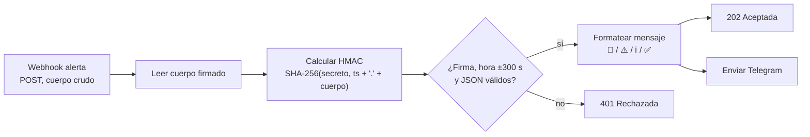

# Alertas SENTINEL-LAB con n8n y Telegram

Flujo: **ESP32 → gateway → n8n (home-server) → Telegram**. Diagramas en
[`PROYECTO.md`](PROYECTO.md#6-alertas-del-sensor-al-móvil-del-responsable).

## Estado (2026-11-22)

| Pieza | Estado |
|---|---|
| Workflow `SENTINEL-LAB · Alertas` en `https://n8n.nexuscloud.sbs` | **Desplegado y activo** (id `SentinelLabAlerts1`) |
| Webhook `POST https://n8n.nexuscloud.sbs/webhook/sentinel-alerts` | **Verificado**: 202 con firma válida y 401 con firma falsa |
| Secreto HMAC compartido | `~/.config/sentinel-lab/alert-secret` (portátil, `chmod 600`) y nodo «Calcular HMAC» del workflow. No está en Git |
| Envío a Telegram | **Pendiente del propietario**: el nodo «Enviar Telegram» está desactivado hasta crear el bot (pasos abajo) |
| Plantilla versionada | [`integrations/n8n/sentinel-alerts.workflow.json`](../integrations/n8n/sentinel-alerts.workflow.json), sin secreto ni credenciales |

## Workflow



La firma se calcula sobre los **bytes exactos** que envía el gateway (opción
*Raw Body* del webhook), así que reordenar las claves del JSON no rompe la
verificación. Cloudflare, delante de n8n, bloquea el User-Agent por defecto de
Python (`error code: 1010`); el gateway envía `User-Agent: SentinelLabGateway/<versión>`.

## Activar Telegram (5 minutos, lo haces tú)

1. En Telegram, abre **@BotFather** → `/newbot` → elige un nombre. Te dará un
   **token del bot**. No lo pegues en ningún chat ni en el repositorio.
2. Escríbele cualquier mensaje a tu bot nuevo. Después abre en el navegador
   `https://api.telegram.org/bot<TOKEN>/getUpdates` y copia el número de
   `"chat":{"id": ...}`: es tu **chat id**.
3. En n8n (`https://n8n.nexuscloud.sbs`), abre **SENTINEL-LAB · Alertas** → nodo
   **Enviar Telegram**:
   - **Credential** → *Create new* → pega el token del bot.
   - **Chat ID** → sustituye `REEMPLAZAR_CHAT_ID` por tu chat id.
   - Activa el nodo (botón *Activate*, o tecla `D`) y guarda.
4. Prueba: `python3 tools/sentinel_gateway.py alert-test` (o agita el iPhone con
   el gateway en marcha). Debe llegar un mensaje al chat.

¿SMS en lugar de Telegram? Sustituye el nodo por **Twilio → Send SMS**. Twilio
cobra por mensaje y necesita una cuenta propia; el resto del workflow no cambia.

## Rotar el secreto

```bash
( umask 077; python3 -c "import secrets;print(secrets.token_hex(32))" > ~/.config/sentinel-lab/alert-secret )
```

Pega el nuevo valor en el campo *Secret* del nodo **Calcular HMAC** y guarda.
Las alertas que estén en la cola del gateway se firman al enviarse, así que las
pendientes usarán el secreto nuevo.

## Seguridad

- Sin firma válida, o con una marca de tiempo de más de 5 minutos, n8n responde
  401 y no envía nada: nadie puede inyectar alertas falsas ni repetir alertas
  antiguas.
- El token del bot vive solo en las credenciales cifradas de n8n.
- El webhook no devuelve datos internos; solo `{"ok":true,"id":...}`.
