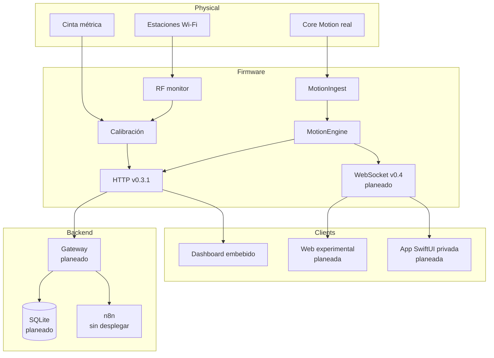

# Arquitectura general

## Fronteras del sistema

SENTINEL-LAB separa cuatro dominios:

1. **Adquisición física**: acelerómetro, gravedad, RSSI y distancias medidas.
2. **Firmware**: adquisición, validación, motores de física y API local.
3. **Presentación**: dashboard embebido, futura web y futura app iOS.
4. **Automatización**: gateway, almacenamiento histórico, n8n y Telegram.

## Principios

- La fuente de movimiento actual es Sensor Logger sobre HTTP Push nativo.
- `accelerometer` se suma a la muestra `gravity` más cercana; si no hay pareja,
  la muestra se descarta.
- `MotionEngine` estima gravedad, magnitud dinámica y transiciones con
  histéresis.
- RSSI crudo y estimación filtrada son conceptualmente distintos.
- El ESP32 debe funcionar sin cliente web conectado.
- La API HTTP v0.3.1 permanece durante la migración.
- n8n no participa en el procesamiento de telemetría de alta frecuencia.

## Datos reales frente a simulación

Todo mensaje simulado está etiquetado en su contrato. El endpoint nativo rechaza
simulación. El dashboard mantiene la simulación separada de la medición real.
Ninguna pantalla principal debe presentar JSON técnico como evidencia física.

## Seguridad

HTTP y WebSocket locales son adecuados solo dentro del AP de laboratorio. El
gateway remoto debe usar TLS, autenticación por dispositivo y endpoints
administrativos no públicos.

## Migración

La reorganización en monorepo es incremental. El firmware funcional no se mueve
ni se reemplaza hasta que el protocolo y las pruebas de la nueva capa estén
validados.
